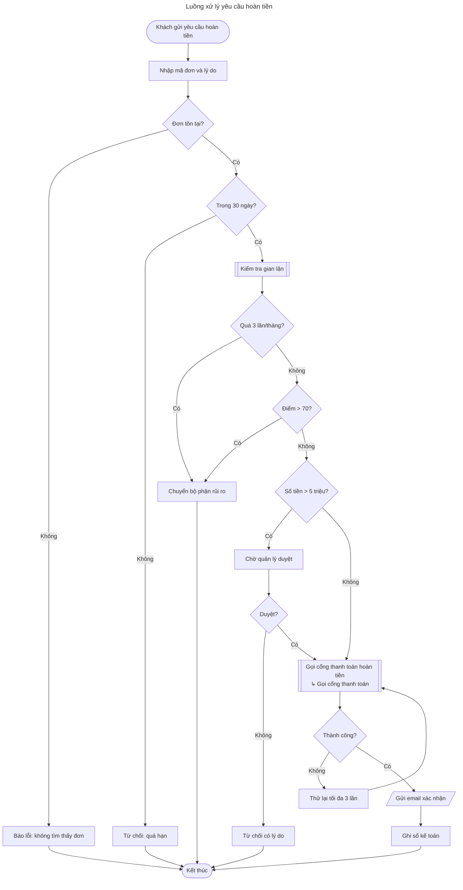
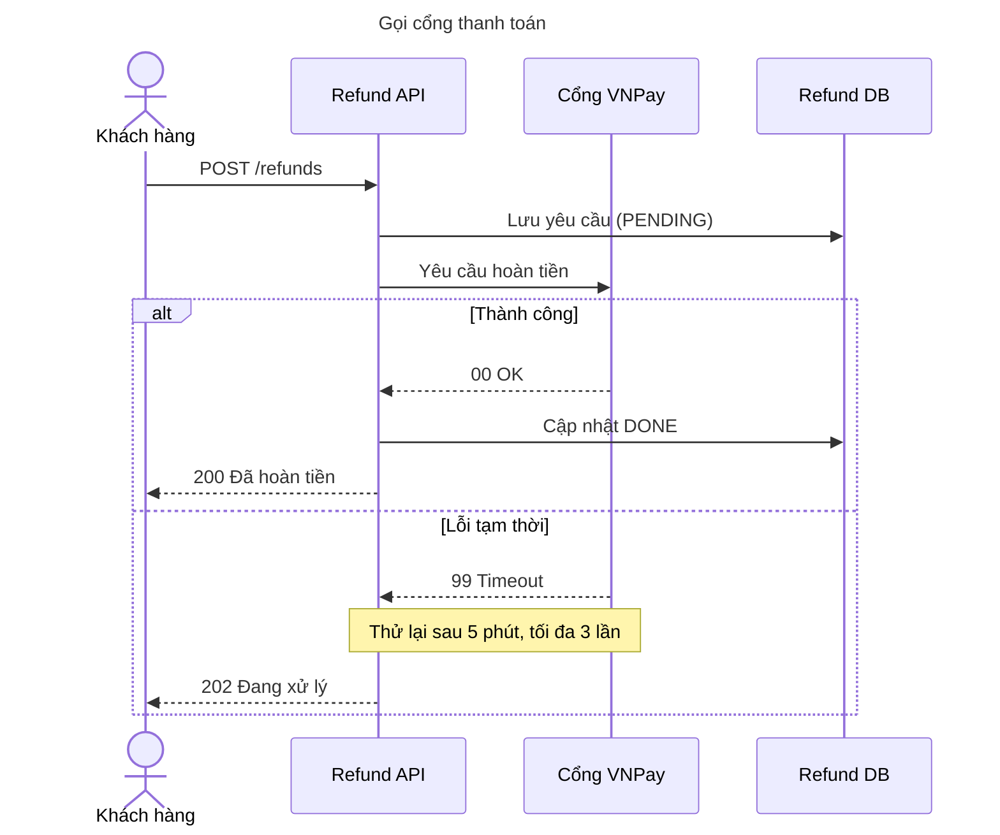

# E2E recook (Zukai 2.2.0): kịch bản B — nguồn Mermaid nhiều trang

Ngày chạy: 2026-11-13 (UTC). Runtime mô phỏng: không có `AskUserQuestion`, không có subagent; review do chính runtime làm bằng giọng reviewer.
Project: `/tmp/claude-0/-home-user-zukai-kobo/4a7ef9ef-051f-57b9-90d6-65ba14b3e4be/scratchpad/e2e/b-proj`
CLI: `C=/home/user/zukai-kobo/skills/draw/scripts/bin/cli.mjs` (Node v22.23.4). Mọi lệnh chạy từ thư mục project.

## 1. Kết luận

Request 1 (file "screenshot.png") bị `extract` từ chối đúng như skill mô tả; request 2 chạy hết pipeline (extract → IR → `cover` 53/53 → validate → emit → bundle → preview → review PASS sau 1 vòng) và ra hai diagram Mermaid đúng nội dung, render sạch. Vấn đề lớn nằm ở text của skill: (a) nguồn nhiều trang mà user chỉ muốn một trang (request 3) không có cách nào làm đúng: `extract` không chọn được trang, `cover` không biết trang, nên làm theo chữ thì phải ghi 24 mục `meta.omitted` cho cả flowchart không ai yêu cầu; (b) "trang khác thành part" mâu thuẫn với "overview không bao giờ tách"; (c) bảng mapping cho sequence/frame được viết theo draw.io nên đọc theo chữ thì facts của Mermaid ra sai (reply thành `sync`, block `alt` không có kind). Ngoài ra `cover` nhận một text trần trong `meta.notes`, đúng điều SKILL.md cấm, và địa chỉ e-mail nhân viên nằm trong `source/original/` mà không bước scan nào thấy.

## 2. Các bước theo từng request

### Request 1: `/zukai:recook docs/screenshot.png`

| SKILL.md step | Việc đã làm (lệnh chính xác) | Kết quả |
|---|---|---|
| Locate draw skill | `<recook-dir>/../draw/scripts/bin/cli.mjs` có tồn tại | Dùng `/home/user/zukai-kobo/skills/draw` |
| Arguments, bullet "A PNG ... is not a source" (SKILL.md:49-52) | `file docs/screenshot.png` → `ASCII text` (nội dung: `not a diagram`, 13 byte). `node $C extract docs/screenshot.png --out <scratch>/b-shot.facts.json` | exit 1: `{"ok":false,"errors":[{"path":"docs/screenshot.png","message":"not a draw.io file: no <mxfile> or <mxGraphModel> element"}]}` |
| Step 1.1 (tạo run folder + copy) | **Không làm.** Bullet của Arguments được hiểu là kiểm tra trước step 1, nhưng thứ tự này không được nói ra (xem L1) | Không có folder thừa |
| Step 1.4 / Arguments | Trả lời 1 dòng + tên các nguồn dùng được + gợi ý `clarify` | Tin nhắn ở dưới |

Tin nhắn gửi user (theo SKILL.md:50-51):

> `docs/screenshot.png` không phải là nguồn recook được: `extract` từ chối nó ("not a draw.io file: no <mxfile> or <mxGraphModel> element"). Nguồn dùng được: file draw.io (`.drawio`, `.xml`, `.drawio.svg`, `.drawio.png` có kèm bản diagram), Mermaid (`.mmd`, hoặc `.md` có khối ```mermaid), hoặc board FigJam (link `figma.com/board/...`). Nếu muốn, tôi vẽ lại bằng chế độ `clarify` của skill draw, lấy hình này làm mô tả.

Kiểm tra phụ trong scratch (không nằm trong project): một PNG thật 1×1 → `this PNG holds no draw.io diagram (no "mxfile" text chunk); export it from draw.io with "Include a copy of my diagram"` (tốt); một file `%PDF-1.4` → `not a draw.io file: ...` (xem L11).

### Request 2: `/zukai:recook --to mermaid docs/thiet-ke-hoan-tien.md`

| SKILL.md step | Việc đã làm (lệnh chính xác) | Kết quả |
|---|---|---|
| Arguments | `--to mermaid` hợp lệ; nguồn `.md` | Không phải hỏi target |
| 1.1 Run folder | Slug: tiêu đề là "Thiết kế chức năng hoàn tiền", tên file `thiet-ke-hoan-tien`. Closing contract đòi slug "short English kebab-case" → chọn `refund-design` (mâu thuẫn, xem M3). `mkdir -p diagrams/20261113_refund-design/source/original && cp docs/thiet-ke-hoan-tien.md diagrams/20261113_refund-design/source/original/` | OK |
| 1.2 extract | `node $C extract diagrams/20261113_refund-design/source/original/thiet-ke-hoan-tien.md --out diagrams/20261113_refund-design/source/refund-design.facts.json` | exit 0; trang `mermaid-1` "Luồng xử lý yêu cầu hoàn tiền" 24 node / 29 edge, hint `flowchart` 100 (`line 8: header "flowchart TD"`); trang `mermaid-2` "Gọi cổng thanh toán" 6 node / 8 edge, hint `sequence` 100 (`line 42: header "sequenceDiagram"`); không có warning |
| "tell the user what was read" | Tin nhắn (A) ở dưới | — |
| 2 Opening questions | Không có AskUserQuestion → một tin nhắn văn bản, câu hỏi đánh số, theo fallback của draw SKILL.md:144-149 (recook không mô tả fallback, xem L3). Không hỏi target (`--to` hợp lệ) | Tin nhắn (B) ở dưới. Trả lời mô phỏng: `1a 2a 3a` (kind như gợi ý cho từng trang, Tổng quan, Kỹ thuật) |
| 3 Write IR | Đọc mapping.md, ir-reference.md (flowchart, sequence). Viết `source/refund-design.ir.json` (flowchart, 20 node, 26 edge) và `source/refund-design-01-gateway-call.ir.json` (sequence, 4 participant, 8 message, 1 `alt`, 1 note). Trang sequence thành part (theo SKILL.md:102), `ref` đặt ở node `call-gateway` "Gọi cổng thanh toán hoàn tiền". Overview: subgraph "Kiểm tra gian lận" gộp thành một bước `subroutine`; nâng hai quyết định "Quá 3 lần/tháng?", "Điểm > 70?" và kết quả "Chuyển bộ phận rủi ro" ra diagram chính; 4 bước còn lại vào `meta.omitted`. Reply `-->>` ghi là `return` (trái với mapping.md:36 đọc theo chữ, xem M2) | — |
| 4 Coverage gate | `node $C cover diagrams/20261113_refund-design/source/refund-design.facts.json diagrams/20261113_refund-design` | exit 0 `{"ok":true,"units":53,"covered":53,"missing":[]}` ngay lần đầu |
| 5 / CC step 2 validate | `node $C validate diagrams/20261113_refund-design/source/refund-design.ir.json` và `... refund-design-01-gateway-call.ir.json` | cả hai `ok`, `warnings: 0` (không có `size:` vì ngưỡng là 40, xem `check-model.mjs:16`; câu hỏi `size:` trong kịch bản không xảy ra) |
| CC step 3 emit + bundle | `node $C emit --to mermaid diagrams/20261113_refund-design/source/<id>.ir.json --out diagrams/20261113_refund-design/mermaid/<id>.mmd` (2 lần); `node $C bundle --to mermaid --out diagrams/20261113_refund-design/refund-design.md --title "Thiết kế chức năng hoàn tiền" diagrams/20261113_refund-design` | 0 warning; `order: ["refund-design","refund-design-01-gateway-call"]` |
| CC step 4 preview | `node $C preview <file> --max-px 1600` cho `mermaid/refund-design.mmd` (2 tile), `mermaid/refund-design-01-gateway-call.mmd`, `refund-design.md` (3 ảnh) | Đã mở cả 6 PNG (mục 4) |
| CC step 4 review (vòng 1) | Đọc review-checklist.md, review bằng giọng reviewer | `Verdict: PASS`, 4 polish (ở dưới) |
| CC step 4 sau PASS | Áp polish là sửa IR thuần: lý do trong `meta.omitted` viết bằng tiếng Việt (bundle in chúng cho người đọc). `validate` → `cover` (53/53) → `emit` → `bundle` lại, không review vòng mới | OK |
| CC step 5-6 | Báo cáo (mục 5), offer target khác 1 dòng | — |

Tin nhắn (A), "what was read":

> Đã đọc `docs/thiet-ke-hoan-tien.md` (Mermaid trong Markdown, 2 trang):
> - Trang "Luồng xử lý yêu cầu hoàn tiền": 24 node, 29 cạnh; kind gợi ý `flowchart` (dòng 8: header "flowchart TD").
> - Trang "Gọi cổng thanh toán": 6 node, 8 cạnh; kind gợi ý `sequence` (dòng 42: header "sequenceDiagram").
> - Cảnh báo của facts: không có.

Tin nhắn (B), câu hỏi mở đầu (một tin nhắn):

> Trước khi vẽ, cho tôi hỏi 3 câu (trả lời theo mã, ví dụ "1a 2a 3a", hoặc "default"):
>
> 1. Loại diagram cho trang "Luồng xử lý yêu cầu hoàn tiền" (trang nhiều node nhất)? Trang "Gọi cổng thanh toán" sẽ thành một part `sequence` (Trình tự); muốn đổi trang nào thì ghi tên trang và loại.
>    - 1a. Lưu đồ (flowchart) – gợi ý: các bước và quyết định của một quy trình từ đầu đến cuối (nguồn có header "flowchart TD", dòng 8)
>    - 1b. Trình tự (sequence): ai gọi ai, theo thứ tự nào, có phản hồi và nhánh lỗi
>    - 1c. Swimlane (activity): mỗi làn một tác nhân, ai làm bước nào, bàn giao, việc song song
>    - 1d. Trạng thái (state): các trạng thái của một đối tượng và sự kiện chuyển trạng thái
>    - 1e. Dữ liệu (er): thực thể, thuộc tính khóa, quan hệ một-nhiều
>    - 1f. Lớp (class): kiểu, interface, thành viên, kế thừa hoặc hợp thành
>    - 1g. Kiến trúc (architecture): thành phần triển khai, kho dữ liệu, hàng đợi, hệ thống ngoài và kết nối
> 2. Mức chi tiết?
>    - 2a. Tổng quan (overview) – gợi ý: chỉ diagram chính, khoảng 15 phần tử; luồng con "Kiểm tra gian lận" gộp thành một bước, quy tắc quyết định của nó được đưa lên diagram chính
>    - 2b. Chi tiết (detailed): diagram chính và mỗi luồng con đáng vẽ riêng thành một diagram con, liên kết bằng `ref`
> 3. Góc nhìn của diagram?
>    - 3a. Kỹ thuật (technical) – gợi ý: cho developer, reviewer; giữ tên component, endpoint, dữ liệu
>    - 3b. Nghiệp vụ (business): cho PM, khách hàng, vận hành; chỉ luồng và quy tắc nghiệp vụ, bỏ tên kỹ thuật
>    - 3c. Cả hai (both): hai bản cho mỗi diagram (ở đây thành 4 diagram)

Review vòng 1 (giọng reviewer):

```text
Verdict: PASS
Images: refund-design: opened (2 tile của file lẻ + 2 tile trong bundle) ; refund-design-01-gateway-call: opened (file lẻ + bundle)
Findings:
- [polish] [layout] refund-design-01-gateway-call / m-save-pending, m-update-done: lifeline của "Cổng VNPay" cắt qua chữ "Lưu yêu cầu (PENDING)" và "Cập nhật DONE" -> đặt participant refund-db trước vnpay
- [polish] [structure] refund-design / retry: vòng "Thử lại tối đa 3 lần" không có lối ra sau lần thứ 3 thất bại -> nguồn cũng không có; không thêm (recook cấm bịa), nêu trong báo cáo
- [polish] [structure] refund-design-01-gateway-call: có part trong khi scope là overview (checklist mục 8) -> giữ, vì recook biến mỗi trang nguồn thành một diagram (SKILL.md:100-102)
- [polish] [wording] refund-design / meta.omitted: lý do viết bằng tiếng Anh nhưng bundle in chúng cho người đọc tiếng Việt -> viết lại lý do bằng tiếng Việt
```

Polish đã áp: mục 4 (lý do tiếng Việt). Không áp: mục 1 (recook SKILL.md "Order comes from the facts" cấm đổi thứ tự participant), mục 2 và 3 (lý do như trên).

### Request 3: `/zukai:recook --to mermaid --kind sequence docs/thiet-ke-hoan-tien.md chỉ lấy sequence`

| SKILL.md step | Việc đã làm (lệnh chính xác) | Kết quả |
|---|---|---|
| Skill nói gì về nguồn nhiều trang khi user muốn một trang | Với file: chỉ có "one diagram per page unless the user says otherwise" (SKILL.md:100). "Recook only the ones the user asked for" chỉ nằm trong đoạn FigJam (SKILL.md:79-82). Không có lệnh hay cờ nào để chọn trang của một file | Lỗ hổng, xem H1 |
| Arguments | `--kind sequence` bỏ câu hỏi kind, nhưng với nguồn 2 trang thì không rõ `--kind` áp cho trang nào (L7); hiểu kèm "chỉ lấy sequence" → trang `mermaid-2` | — |
| 2 Opening questions | Còn scope và view → một tin nhắn: "1. Mức chi tiết? 1a Tổng quan (overview) – gợi ý … 1b Chi tiết (detailed) … 2. Góc nhìn của diagram? 2a Kỹ thuật (technical) – gợi ý … 2b Nghiệp vụ (business) … 2c Cả hai (both) …" | Trả lời mô phỏng (PM): "1a 2a" |
| 1.1 Run folder | "into its own run": slug theo SKILL.md:61 lại ra `refund-design` → trùng folder của request 2 (closing-contract.md:8 nói re-emit thì dùng lại folder). Tự chọn `refund-gateway-call` (M3). `mkdir -p diagrams/20261113_refund-gateway-call/source/original && cp docs/thiet-ke-hoan-tien.md diagrams/20261113_refund-gateway-call/source/original/` | — |
| 1.2 extract | `node $C extract diagrams/20261113_refund-gateway-call/source/original/thiet-ke-hoan-tien.md --out diagrams/20261113_refund-gateway-call/source/refund-gateway-call.facts.json` | Cả 2 trang. Thử chọn trang: `node $C extract <file> mermaid-2 --out <scratch>/x.json` → exit 1 `cannot read file: ENOENT ... b-proj/mermaid-2` (đối số thêm bị coi là phần của board) |
| 3 IR | `source/refund-gateway-call.ir.json` = IR sequence của request 2, đổi note đầu | — |
| 4 cover (lần 1) | `node $C cover diagrams/20261113_refund-gateway-call/source/refund-gateway-call.facts.json diagrams/20261113_refund-gateway-call` | exit 2, `units 53, covered 17`, 36 text của flowchart bị missing. "Thành công?" (N) và "Thử lại tối đa 3 lần" (N1) của flowchart lại được tính là covered nhờ nhãn `alt` "Thành công" và note "Thử lại sau 5 phút, tối đa 3 lần" (M7) |
| 4 cover (sửa theo chữ) | "For each one … add the meta.omitted entry" → 24 mục (bỏ trùng "Có"/"Không"), mỗi mục `"<text>": thuộc trang "Luồng xử lý yêu cầu hoàn tiền", người dùng chỉ lấy sequence` | exit 0, 53/53 |
| 5 Closing contract | `validate` (0 warning), `emit --to mermaid … --out diagrams/20261113_refund-gateway-call/mermaid/refund-gateway-call.mmd`, `bundle --to mermaid --out diagrams/20261113_refund-gateway-call/refund-gateway-call.md --title "Gọi cổng thanh toán" diagrams/20261113_refund-gateway-call`, `preview` cho cả hai file | Diagram giống hệt part của request 2 (diff body = rỗng). Nhưng `refund-gateway-call.md` có mục "Not shown on purpose:" dài 24 dòng, toàn text của flowchart, nằm ngay dưới một sequence diagram. PNG của bundle không có phần này nên review không thấy |

## 3. Lỗi tìm thấy

### Skill text problem

**H1 (High). Nguồn file nhiều trang, user chỉ muốn một trang: không có đường làm đúng.**
Bằng chứng: SKILL.md:100 ("one diagram per page unless the user says otherwise") không nói làm gì khi user "says otherwise"; "Recook only the ones the user asked for" chỉ có ở đoạn FigJam (SKILL.md:79-82). `extract` không chọn được trang (đối số thứ hai → `cannot read file: ENOENT ... mermaid-2`), `cover` kiểm mọi trang (`cover.mjs:72-83`), nên request 3 ra `covered 17 / 53`. Làm theo chữ step 4 thì phải ghi 24 mục `meta.omitted`, và bundle in cả 24 mục cho người đọc.
Đề xuất: thêm `--page <id|name>` (lặp được) cho `extract` (chỉ giữ trang đó trong facts, ghi các trang bị bỏ vào một trường `skipped`) hoặc cho `cover`; trong SKILL.md step 1/2 viết: "When the user names the pages to recook, pass them with `--page`; the report names the pages left out, and their texts need no `meta.omitted` entry."

**M1 (Medium). Pages, parts và `overview` mâu thuẫn nhau.**
recook SKILL.md:102 "Page 'Orders ERD' becomes an `er` part" và step 3 (part chỉ đi với `detailed`, SKILL.md:132-135) ngược với draw SKILL.md:112 "never split under `overview`" và review-checklist.md:46 (mục 8: "parts exist only under `detailed`"). Không có quy tắc nào nói element nào của diagram chính mang `ref` tới trang kia (chỉ có trường hợp `link`, SKILL.md:135-139). Tôi đã làm: part `refund-design-01-gateway-call`, `ref` trên "Gọi cổng thanh toán hoàn tiền"; reviewer phải hạ mục 8 xuống polish. IR cũng không ghi scope (`meta` không có `scope`), nên reviewer chỉ biết scope nhờ `meta.notes`.
Đề xuất: viết rõ "every page of the source is its own diagram whatever the scope; a page that details an element of the main page is a part with `ref` on that element; `overview` only collapses the sub-flows inside a page", và thêm ngoại lệ này vào checklist mục 8.

**M2 (Medium). mapping.md:36: reply trong Mermaid đọc theo chữ thành `sync`.**
Facts của `-->>` là `"dashed": true, "endArrow": "block"` (`extract-mermaid.mjs:632`, `SEQ_HEAD['>>'] = 'block'`). Quy tắc "`dashed` with an open end is `return`, an open end alone `async`, else `sync`" cho `00 OK`, `200 Đã hoàn tiền`, `99 Timeout`, `202 Đang xử lý` thành `sync`. Tôi ghi `return` và giải thích trong `meta.notes`.
Đề xuất: "`dashed` (any end) is `return`; an `open` end on a solid line is `async`; else `sync`", hoặc cho extractor chuẩn hóa ra `open` khi gặp `-->>`.

**M3 (Medium). Slug của run: hai quy tắc ngược nhau, và không có quy tắc cho lần recook thứ hai.**
SKILL.md:61 "the slug from the source's title or file name" (ra `thiet-ke-hoan-tien` hoặc tiếng Việt) và closing-contract.md:7 "short English kebab-case name of the feature". Request 3 cùng nguồn, cùng ngày nên ra cùng folder, mà closing-contract.md:8 nói re-emit "reuses the folder"; làm theo chữ sẽ ghi đè/trộn với run của request 2 (`source/refund-design.ir.json` đã có).
Đề xuất: "an English kebab-case name of what the source shows; when `diagrams/<today>_<slug>/` already holds another run, add the recooked page's name (`refund-design-gateway-call`)".

**M4 (Medium). Dữ liệu cá nhân trong `source/original/` không bị chặn.**
`[redacted e-mail]` nằm ở phần văn xuôi (dòng 3 của tài liệu), ngoài khối Mermaid, nên không vào facts, không vào IR, và secret scan không thấy (scan có bắt địa chỉ này nếu nó nằm trong label: chạy thử `validate` trong scratch → `personal-data ... possible e-mail address`). Nhưng SKILL.md:62 bắt copy nguồn "unchanged" vào run folder, mà closing-contract.md:104-105 nói "A run folder is usually committed or sent to a client". `grep -c [redacted] .../source/original/thiet-ke-hoan-tien.md` → 1, trong cả hai run. SKILL.md:179-181 chỉ nói về label và sticky.
Đề xuất: cho `extract` scan toàn bộ file nguồn và đưa kết quả vào `warnings` của facts; SKILL.md yêu cầu báo cáo nêu rõ và hỏi user có giữ `source/original/` khi commit hay không.

**M5 (Medium). `overview` "about 15 elements" + "collapsed into one step that keeps its decisive rule" không làm được nếu giữ quy tắc "Content stays".**
Riêng phần ngoài subgraph đã có 16 node; diagram chính ra 20 node. Một "step" không chứa được hai quyết định ("Quá 3 lần/tháng?", "Điểm > 70?") nếu không viết lại nhãn, mà SKILL.md:117 cấm viết lại → tôi theo câu của draw SKILL.md:99-101 ("lift that rule … as its own decision or step"). "Elements" cũng không rõ là chỉ node hay cả edge.
Đề xuất: nói "about 15 elements besides what the source draws outside its sub-flows", và "lift its decisive rules as their own decisions, labels copied from the source".

**L1 (Low). Request 1: thứ tự kiểm tra không được nói ra.** Bullet ở SKILL.md:49-52 ("`extract` refuses it") nằm trước step 1, nhưng step 1.1 (SKILL.md:60-62) bảo "Make the run folder now" và copy nguồn trước khi gọi `extract`. Làm theo chữ step 1 sẽ để lại `diagrams/20261113_screenshot/source/original/screenshot.png` rồi dừng. Ngoài ra "Say so in one line" (SKILL.md:50) với "quote the error" (SKILL.md:83) chồng nhau. Đề xuất: "Run `extract` on the file where it is first (`--out` into a temp path); make the run folder only after it succeeds."

**L2 (Low). "offer the draw skill's `clarify` mode with the picture as the description" (SKILL.md:51).** clarify-protocol.md không có đầu vào nào là hình ảnh (không có chữ "picture"/"image"/"screenshot"), nên gợi ý này ngầm là "đọc hình bằng mắt", chỉ là ở skill khác. Ở đây file còn không phải hình (ASCII "not a diagram"). Đề xuất: "offer `clarify`, with the user describing the flow (the picture can help them, but is not read into an IR)", và bỏ gợi ý này khi file không phải hình.

**L3 (Low). Câu hỏi mở đầu chỉ được mô tả cho `AskUserQuestion`.** SKILL.md:93-94 "in one `AskUserQuestion` call"; fallback văn bản phải suy ra từ draw SKILL.md:144-149. Hai chỗ ngược nhau: recook nói chỉ các hint có điểm mới là option (SKILL.md:99; ở đây chỉ có 1 hint nên còn đúng 1 option), draw text-mode nói liệt kê đủ 7 kind; "pick 'Other'" (SKILL.md:102) không có nghĩa trong tin nhắn văn bản. Đề xuất: thêm một câu cho runtime không có tool: "one text message as the draw skill says; the kind question lists all seven kinds with the suggested one first."

**L4 (Low). mapping.md:14 thiếu shape `process`.** Extractor Mermaid xuất `"shape": "process"` (24 node của trang 1) nhưng bảng facts không có giá trị này, và hàng flowchart chỉ có `box`, `rounded` → `process`. Đọc theo chữ mapping.md:5-6 ("When a shape fits no row … belongs to another kind or to `meta.omitted`") thì sai. Đề xuất: thêm `process` vào danh sách và vào hàng `box`, `rounded`.

**L5 (Low). mapping.md:37: frame của Mermaid không khớp mô tả.** Facts của Mermaid: `label: "Thành công"`, `texts: ["Lỗi tạm thời"]`, operator nằm trong `detail: "alt e4..e6 | else e7..e8"`; mapping thì nói operator nằm ở đầu label và branch là dòng bắt đầu bằng `else`. Note cũng chỉ có `detail: "over API,PG; after e7"`, không có box để so "overlaps". Đề xuất: ghi định dạng `detail` của Mermaid vào mapping.md, hoặc cho extractor xuất `label: "alt Thành công"`, `texts: ["else Lỗi tạm thời"]` giống draw.io.

**L6 (Low). mapping.md:55 "`terminal` … with a start or end word".** "Khách gửi yêu cầu hoàn tiền" là terminal (`([...])`) nhưng không có từ start/end nào → đọc theo chữ thì không có hàng nào. Đề xuất: "`terminal` → `terminal`; `ellipse`, `initial`, `final` → `terminal` when they carry a start or end word".

**L7 (Low). `--kind` với nguồn nhiều trang.** Không nói `--kind` áp cho trang nào (trang nhiều node nhất? trang khớp kind?). Request 3 chỉ hiểu được nhờ "chỉ lấy sequence". Đề xuất: "`--kind` on a source with several pages selects the pages whose best hint is that kind."

**L8 (Low). Id: "A source id that is already such a name is kept" (SKILL.md, Ids).** `KH`, `API`, `PG`, `DB`, `A`…`Z`, `C1` đều là ASCII hợp lệ; closing-contract.md:114-115 lại cấm "counters alone". Tôi đã đặt lại hết (`customer`, `refund-api`, `start`, …). Đề xuất: "kept when it is an English word or name of the element (`api`, `orders`); one- or two-letter ids are replaced".

**L9 (Low). Lý do trong `meta.omitted` viết tiếng Anh (ví dụ ở SKILL.md:150-151) nhưng bundle in chúng cho người đọc.** Đề xuất: ví dụ dùng ngôn ngữ của user, hoặc nói "the reason in the user's language".

**L10 (Low). "Order comes from the facts" chặn sửa layout.** Polish của reviewer (đặt Refund DB trước Cổng VNPay để lifeline không cắt chữ) không áp được. Đề xuất: cho phép đổi thứ tự participant khi nguồn không vẽ vị trí (Mermaid), và ghi lại trong `meta.notes`.

### CLI bug

**M6 (Medium). `cover` nhận một text trần trong `meta.notes`.** SKILL.md:159 nói "never put a text into `meta.notes` to hide it", nhưng `cover.mjs:53` coi mỗi mục `meta.notes` là một chỗ chứa hợp lệ. Thử trong scratch: bỏ "Gắn cờ nghi ngờ" khỏi `meta.omitted` → `exit 2 … missing … "Gắn cờ nghi ngờ"`; thêm `"Gắn cờ nghi ngờ"` (không lý do) vào `meta.notes` → `{"ok":true,"units":53,"covered":53}` exit 0. Đề xuất: chỉ nhận `meta.omitted`, và đòi có lý do (`"<text>": <reason>`); hoặc nhận `meta.notes` chỉ khi mục đó bắt đầu bằng `moved:` / `merged:`.

**M7 (Medium). `cover` không biết trang: một text của trang này được tính là "covered" bởi element của diagram khác.** Request 3: IR chỉ có sequence, nhưng "Thành công?" (flowchart, N) và "Thử lại tối đa 3 lần" (flowchart, N1) không bị báo missing, vì nhãn `alt` "Thành công" và note "Thử lại sau 5 phút, tối đa 3 lần" chứa đủ các từ đó. Docstring (`cover.mjs:13-15`) có nhắc tới từ ngắn, nhưng ở đây là cả một bước của diagram khác. Đề xuất: khớp text của mỗi trang với IR có `meta.notes[0]` ghi `page "<name>"` (hoặc một trường `meta.page`); và `includes` trên chuỗi compact thực ra là so chuỗi con liền nhau, không phải "letters in that order" như docstring nói.

**L11 (Low). Thông báo của `extract` với file không đọc được.** `docs/screenshot.png` (không phải PNG) và một file PDF đều nhận `not a draw.io file: no <mxfile> or <mxGraphModel> element`. Thông báo không nói file trông như thế nào và các định dạng nào dùng được, trong khi SKILL.md bảo runtime "name the sources that work". Đề xuất: thêm `hint` liệt kê `.drawio/.xml/.drawio.svg/.drawio.png/.mmd/.md/board JSON`; với `.png`/`.pdf`/`.jpg` nói thẳng "a picture or PDF is not a source".

**L12 (Low, emitter). Bundle luôn in tiêu đề "Not shown on purpose:" bằng tiếng Anh** trong một tài liệu tiếng Việt (`refund-design.md`, `refund-gateway-call.md`). Đề xuất: lấy theo `meta.lang` hoặc theo ngôn ngữ của nhãn, hoặc để runtime truyền vào.

Ghi nhận không phải lỗi: extractor đặt "Tính số tiền hoàn" (E) vào subgraph KT dù E được khai báo ở dòng 14, ngoài subgraph. Render khối gốc (`preview` của `b-misc/src1.mmd`, tile 1) cho thấy Mermaid cũng vẽ E trong khung "Kiểm tra gian lận", nên extractor trung thành với nguồn.

## 4. Đánh giá diagram (các PNG đã mở)

| PNG | Đánh giá |
|---|---|
| `/tmp/zukai-preview/refund-design-mmd-8da47e27-1.png`, `-2.png` (flowchart lẻ, 2 tile, overlap 211 px) | Đúng logic so với nguồn: 5 nhánh kết thúc (không tìm thấy đơn, quá hạn, rủi ro, từ chối có lý do, thành công) dồn về "Kết thúc"; nhãn Có/Không đặt đúng nhánh; vòng retry vẽ thành đường quay lên "Gọi cổng thanh toán hoàn tiền". Chữ đọc được ở scale 1. Diagram cao và hẹp, nhiều đường dọc dài ở bên trái (cạnh "Không" của "Đơn tồn tại?" chạy gần hết chiều cao), nhưng không có gì chồng lên nhau. Node `ref` hiện slug `↳ refund-design-01-gateway-call` bị cắt giữa từ (đúng như target-mermaid.md nói về file lẻ) |
| `/tmp/zukai-preview/refund-design-md-52690ddc-d1-1.png`, `-d1-2.png` (flowchart trong bundle) | Giống file lẻ; node ref hiện `↳ Gọi cổng thanh toán`, xuống dòng đúng chỗ. Đạt |
| `/tmp/zukai-preview/refund-design-01-gateway-call-mmd-517886af.png` và `/tmp/zukai-preview/refund-design-md-52690ddc-d2.png` (sequence lẻ và trong bundle) | Đúng: actor "Khách hàng", 3 participant, `alt` [Thành công] / [Lỗi tạm thời], reply nét đứt, note vàng "Thử lại sau 5 phút, tối đa 3 lần" nằm giữa 99 Timeout và 202. Lỗi nhỏ: lifeline "Cổng VNPay" cắt qua chữ "Lưu yêu cầu (PENDING)" và "Cập nhật DONE" (Mermaid luôn vẽ vậy khi message nhảy qua một participant) |
| `/tmp/zukai-preview/refund-gateway-call-mmd-36418931.png`, `/tmp/zukai-preview/refund-gateway-call-md-5dd3842b-d1.png` (request 3) | Giống hệt sequence ở trên. PNG không cho thấy 24 dòng "Not shown on purpose" của bundle, nên reviewer không thể phát hiện chúng bằng ảnh |
| `/tmp/zukai-preview/src1-mmd-7d5f6858-1.png` (khối gốc, chỉ để đối chiếu; mới mở tile 1/4) | Xác nhận Mermaid vẽ "Tính số tiền hoàn" trong khung "Kiểm tra gian lận" |

## 5. Báo cáo cuối runtime sẽ gửi user cho request 2 (nguyên văn)

---

Đã recook xong `docs/thiet-ke-hoan-tien.md` thành Mermaid.

**Run folder:** `diagrams/20261113_refund-design/`
**File gộp (mở file này trước):** `diagrams/20261113_refund-design/refund-design.md`
File lẻ: `mermaid/refund-design.mmd`, `mermaid/refund-design-01-gateway-call.mmd`; IR ở `source/`; bản gốc không sửa ở `source/original/thiet-ke-hoan-tien.md`, facts ở `source/refund-design.facts.json`.

**Nguồn đã đọc:** file Markdown có Mermaid, 2 trang: "Luồng xử lý yêu cầu hoàn tiền" (flowchart, 24 node, 29 cạnh) và "Gọi cổng thanh toán" (sequence, 6 node, 8 cạnh). Facts không có cảnh báo nào.

**Diagram trong file gộp:**
1. `refund-design`: Luồng xử lý yêu cầu hoàn tiền (flowchart, diagram chính). Đi từ lúc khách gửi yêu cầu, qua kiểm tra đơn, hạn 30 ngày, kiểm tra gian lận (quá 3 lần/tháng, điểm > 70 thì chuyển bộ phận rủi ro), duyệt của quản lý khi số tiền > 5 triệu, rồi gọi cổng thanh toán, gửi email xác nhận và ghi sổ kế toán.
2. `refund-design-01-gateway-call`: Gọi cổng thanh toán (sequence, part của bước "Gọi cổng thanh toán hoàn tiền"). Refund API lưu yêu cầu PENDING, gọi Cổng VNPay; thành công thì cập nhật DONE và trả 200, lỗi tạm thời thì trả 202 và thử lại sau 5 phút, tối đa 3 lần.

Kind của cả hai giống kind gợi ý của nguồn. Góc nhìn: Kỹ thuật (technical), mức chi tiết: Tổng quan (overview), theo câu trả lời của bạn.

**Cảnh báo của CLI:** không có (validate, emit và bundle đều 0 cảnh báo).

**Thay đổi so với nguồn:**
- Giữ nguyên: mọi nhãn, giữ đúng chữ của nguồn; trang "Gọi cổng thanh toán" giữ nguyên toàn bộ.
- Tách thành part: trang "Gọi cổng thanh toán" là diagram riêng, liên kết từ bước "Gọi cổng thanh toán hoàn tiền" (trong file gộp bước này có dòng thứ hai "↳ Gọi cổng thanh toán").
- Gộp (mức Tổng quan): luồng con "Kiểm tra gian lận" thành một bước; hai quyết định "Quá 3 lần/tháng?", "Điểm > 70?" và kết quả "Chuyển bộ phận rủi ro" được đưa lên diagram chính.
- Bỏ ra (không vẽ có chủ đích):
  - "Tính số tiền hoàn": bước nằm trong luồng con "Kiểm tra gian lận", gộp vào bước đó (mức Tổng quan)
  - "Lấy lịch sử hoàn tiền": bước nằm trong luồng con "Kiểm tra gian lận", gộp vào bước đó (mức Tổng quan)
  - "Gắn cờ nghi ngờ": bước nằm trong luồng con "Kiểm tra gian lận", trước "Chuyển bộ phận rủi ro", gộp vào bước đó (mức Tổng quan)
  - "Chấm điểm rủi ro": bước nằm trong luồng con "Kiểm tra gian lận", gộp vào bước đó (mức Tổng quan)
- Đổi hình: "Ghi sổ kế toán" nguồn vẽ hình trụ (kho dữ liệu); flowchart của Zukai không có kho dữ liệu, nên nó là một bước thường.
- Thêm: không thêm gì.
- Nối theo vị trí: không có cạnh nào.
- Nguồn còn thiếu (không tự thêm): sau "Thử lại tối đa 3 lần" mà vẫn thất bại thì nguồn không có kết quả nào; vòng thử lại không có lối ra ngoài nhánh thành công.

**Độ phủ:** 53/53 text của nguồn có trong diagram hoặc trong danh sách bỏ ra.

**Dữ liệu cá nhân:** tài liệu có địa chỉ e-mail của một nhân viên ở phần văn bản (dòng 3), ngoài các khối Mermaid. Địa chỉ này không nằm trong diagram nào, nhưng vẫn có trong bản gốc được copy vào `source/original/`. Nếu bạn commit hoặc gửi run folder này ra ngoài, nên bỏ hoặc che bản gốc.

**Review:** PASS sau 1 vòng.
Images: refund-design: opened (2 tile của file lẻ + 2 tile trong bundle) ; refund-design-01-gateway-call: opened (file lẻ + bundle)
Góp ý còn lại (không chặn):
- [polish] [layout] refund-design-01-gateway-call / m-save-pending, m-update-done: lifeline của "Cổng VNPay" cắt qua chữ "Lưu yêu cầu (PENDING)" và "Cập nhật DONE" -> đặt participant refund-db trước vnpay (không áp: thứ tự participant giữ theo nguồn)
- [polish] [structure] refund-design / retry: vòng "Thử lại tối đa 3 lần" không có lối ra sau lần thứ 3 thất bại -> nguồn cũng không có; không thêm
- [polish] [structure] refund-design-01-gateway-call: có part trong khi mức là Tổng quan -> giữ, vì mỗi trang của nguồn là một diagram riêng

**Mermaid** (nguyên văn từ `refund-design.md`):

Luồng xử lý yêu cầu hoàn tiền:



Gọi cổng thanh toán:



Muốn có thêm bản draw.io (file sửa được, có liên kết giữa các trang) hoặc FigJam thì cứ nói, tôi xuất thêm.

---

## 6. Câu hỏi chưa rõ

1. Nguồn nhiều trang dưới `overview`: trang thứ hai nên là part (có `ref`) như tôi đã làm, hay là một diagram độc lập không `ref`? Text của recook và checklist mục 8 đang trả lời ngược nhau.
2. Muốn cách chọn trang nào cho file: `extract --page`, `cover --page`, hay cho phép runtime sửa facts? Hiện không có cách nào và SKILL.md cũng không cấm sửa facts.
3. Có nên copy `source/original/` khi nguồn chứa dữ liệu cá nhân ngoài phần diagram? Hay chỉ copy các khối đã extract?
4. Slug của run cho nguồn tiếng Việt: dịch sang tiếng Anh (`refund-design`) hay bỏ dấu tên file (`thiet-ke-hoan-tien`)?
5. "about 15 elements" của `overview` có tính cả edge không, và có được bỏ qua khi phần nằm ngoài các luồng con của nguồn đã vượt 15 không?
6. Kịch bản dự đoán sẽ có cảnh báo `size:`, nhưng ngưỡng của CLI là 40 phần tử (`check-model.mjs:16`) nên không xảy ra, và câu trả lời mô phỏng cho `size:` không được dùng. Ngưỡng 40 có đúng ý không, khi skill nói "about 15 to 20"?

Status: DONE_WITH_CONCERNS
Summary: Request 1 bị từ chối đúng; request 2 chạy hết pipeline, ra hai diagram Mermaid đúng (cover 53/53, review PASS 1 vòng); request 3 cho thấy nguồn nhiều trang mà user chỉ muốn một trang không làm đúng được (cần 24 mục `meta.omitted`). Tìm thấy 1 High, 7 Medium, 12 Low (skill text + CLI).
Concerns/Blockers: các mâu thuẫn trang/part/overview, mapping sequence cho Mermaid, `cover` nhận text trong `meta.notes` và không biết trang, e-mail nhân viên trong `source/original/`.
